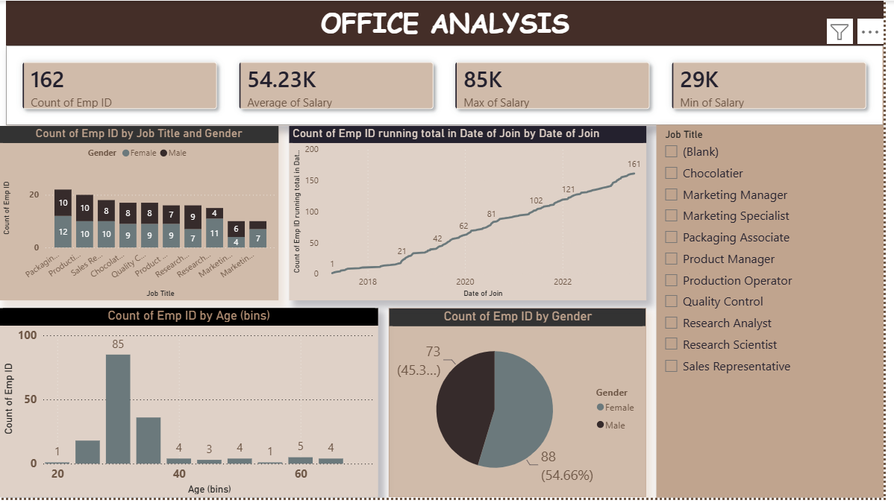

# Workforce Analysis BI Dashboard

An interactive Microsoft Power BI dashboard built for HR teams, people analysts, and hiring managers to explore workforce headcount, compensation distribution, demographics, role breakdown, and cumulative hiring trends across 162 employees. It transforms cleaned employee spreadsheet data into an accessible visual report with interactive role-based filtering.

---

## Table of Contents

- [Visuals & Demo](#visuals--demo)
- [Features & Analytical Breakdown](#features--analytical-breakdown)
- [Key Insights & Observations](#key-insights--observations)
- [Repository Structure](#repository-structure)
- [Installation](#installation)
- [Usage Examples](#usage-examples)
- [Data Quality Notes & Future Enhancements](#data-quality-notes--future-enhancements)
- [Contributing & License](#contributing--license)

<<<<<<< HEAD
---
=======

>>>>>>> 0a9f99fdc47172fccdd12ba2140c934fa4039f0e

## Visuals & Demo



The dashboard brings together executive KPI cards, multi-dimensional charts, and a dynamic role slicer on a single canvas so viewers can move from high-level workforce totals to specific job titles.

### Core KPIs at a Glance

| Metric | Value | Analytical Role |
| :--- | :--- | :--- |
| **Total Employees** | **162** | Headline employee count (`Count of Emp ID`) across the workforce overview |
| **Average Salary** | **54.23K** | Mean compensation benchmark across tracked employees[cite: 1, 2] |
| **Maximum Salary** | **85K** | Upper salary bound observed in the dataset[cite: 1, 2] |
| **Minimum Salary** | **29K** | Lower salary bound observed in the dataset[cite: 1, 2] |

---

## Features & Analytical Breakdown

- **Employee & Compensation Overview:** Highlights total headcount (`162`) alongside average (`54.23K`), maximum (`85K`), and minimum (`29K`) salary KPI cards for immediate workforce and pay-band context[cite: 1, 2].
- **Job Title & Gender Distribution (`Count of Emp ID by Job Title and Gender`):** A stacked bar chart comparing headcount and gender split across roles including **Packaging Associate**, **Production Operator**, **Sales Representative**, **Chocolatier**, **Quality Control**, **Product Manager**, **Research Analyst**, **Research Scientist**, **Marketing Manager**, and **Marketing Specialist**[cite: 1, 2].
- **Gender Breakdown (`Count of Emp ID by Gender`):** A donut chart showing workforce gender representation with **88 Female (54.66%)** and **73 Male (45.34%)**[cite: 1, 2].
- **Age Group Distribution (`Count of Emp ID by Age (bins)`):** Groups employees into age bins to surface generational and career-stage concentration across the organization[cite: 1, 2].
- **Cumulative Joining Trend (`Count of Emp ID running total in Date of Join by Date of Join`):** Tracks cumulative employee join dates over time to illustrate multi-year organizational growth[cite: 1, 2].
- **Interactive Role Filtering:** Provides a **Job Title** slicer on the right-hand panel so stakeholders can filter and inspect workforce patterns by specific job role[cite: 1, 2].

---

## Key Insights & Observations

- **Female-Majority Workforce Split:** Among the gendered breakdown shown in the visual, female employees represent **88 (54.66%)** and male employees represent **73 (45.34%)**.
- **Early-30s Age Concentration:** Age distribution peaks sharply in the early-30s bracket (**85** employees), with smaller counts distributed across younger and older age bins.
- **Steady Multi-Year Expansion:** The cumulative joining line shows continuous growth in headcount across multiple years[cite: 1, 2].
- **Cross-Visual Record Reconciliation:** While the summary KPI card displays **162** employees, the gender chart sums to **161** (`88 + 73`) and the running-total line ends at **161**, providing a helpful data-audit check on record completeness or date/field filtering[cite: 1, 2].

---

## Repository Structure

```text
Workforce-Analysis-BI/
├── Analysis/
├── CLEANED_DATA/
├── RAW-DATA/
├── REPORTS/
├── WORKFORCE_ANALYSIS_DASHBOARD/
└── README.md
